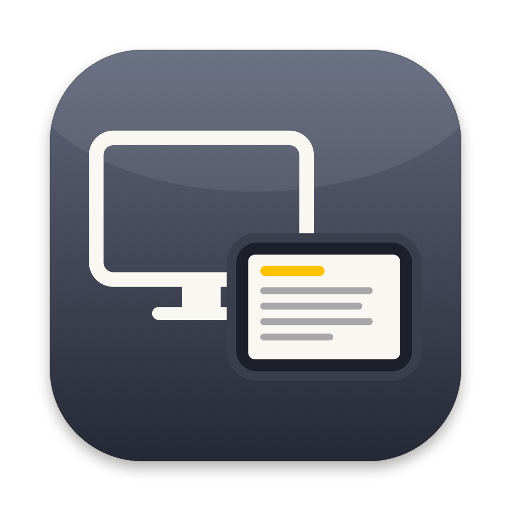
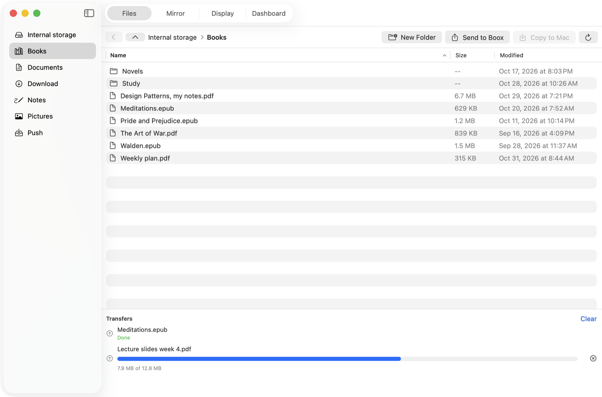
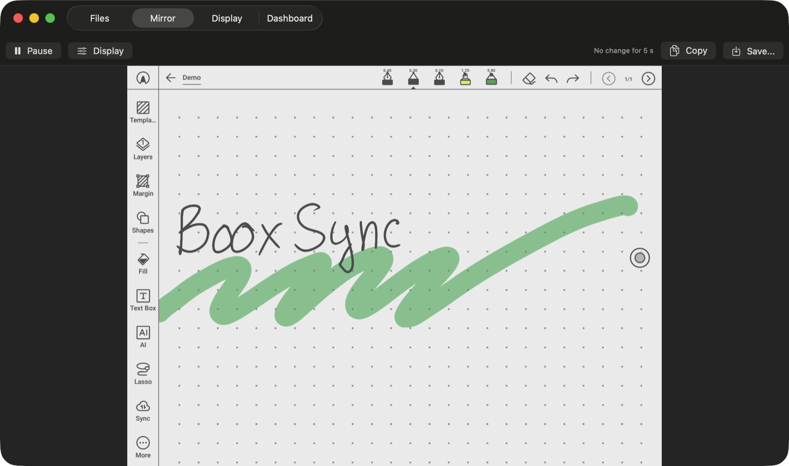
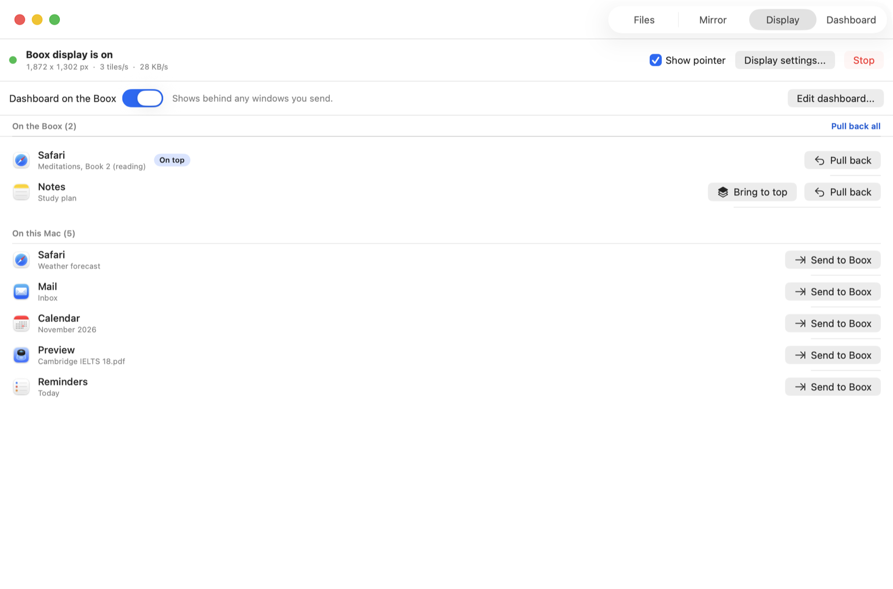
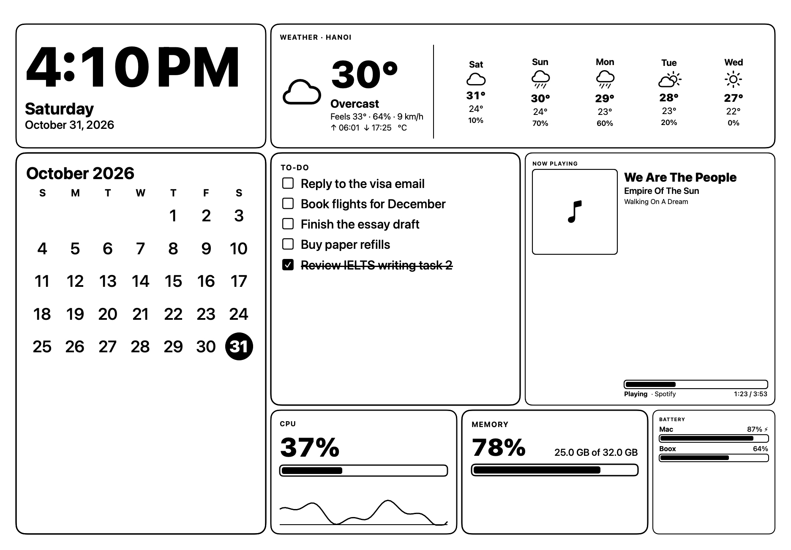
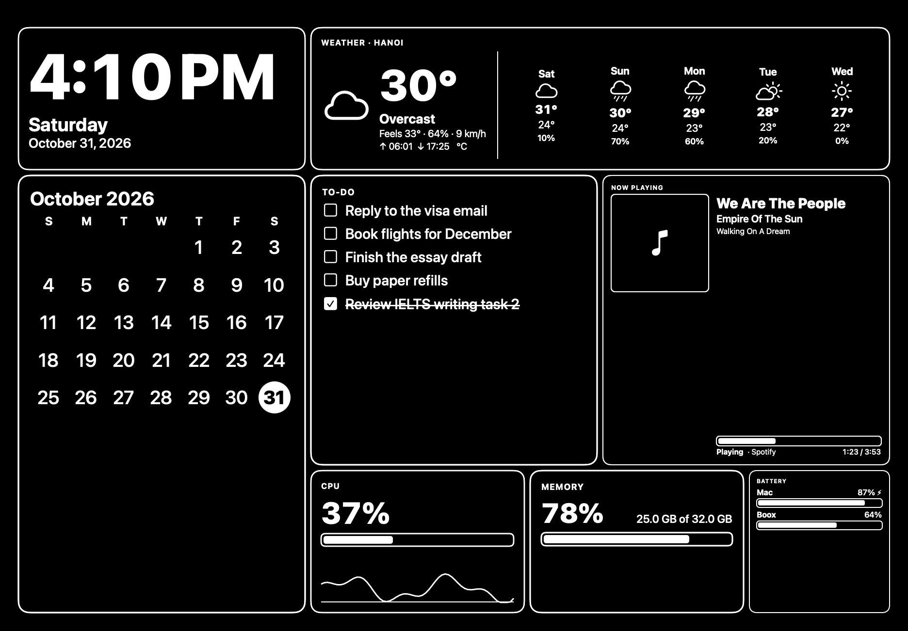
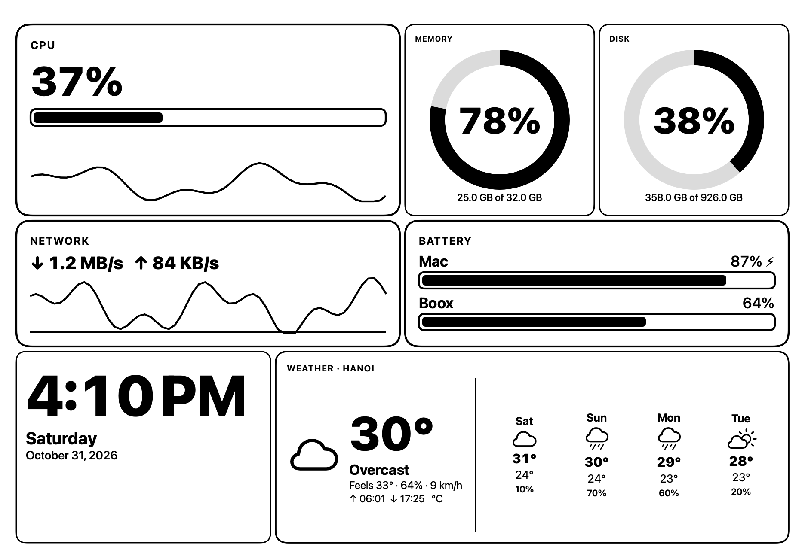

<p align="center"></p>

# BooxSync

Use your Boox e-ink tablet with your Mac over a USB-C cable: move files, watch the Boox screen, and turn the Boox into a second display that can show windows or a dashboard (clock, calendar, weather, to-dos and more). No Wi-Fi, no account, and nothing is installed on the Boox.

- **Files.** Browse the Boox, send files to it and copy files from it, with drag and drop.
- **Mirror.** See what is on the Boox screen in a Mac window, with your pen strokes appearing live while you write.
- **Second display.** Send any Mac window to the Boox, and pull it back with a click. The Boox is meant for reading, so you control it from the Mac.
- **Dashboard.** Fill the Boox with your own layout of clock, date, calendar, weather, to-do list, now playing, system stats and notes.

Tested on a Boox NoteX (firmware 4.1.1) with macOS 26. Other Boox models may work but have not been tried.

## Screenshots

<table>
  <tr>
    <td align="center"><br><b>Files</b>: browse the Boox, drag files in and out</td>
    <td align="center"><br><b>Mirror</b>: the Boox screen on your Mac</td>
  </tr>
  <tr>
    <td align="center"><br><b>Second display</b>: send windows to the Boox and back</td>
  </tr>
</table>

What the Boox shows when no window covers it, in light, dark, and a system-monitor layout:

<p>
  
  
  
</p>

<sub>The screenshots use made-up sample data, not real files, windows, music or reminders.</sub>

## What you need

- A Mac with macOS 14 (Sonoma) or later.
- A Boox tablet and a USB-C cable that carries data (some cables only charge).
- Internet on the Mac only if you use the weather component.

## Install

1. Download `BooxSync-<version>.dmg` from the [Releases page](https://github.com/congtrung6391/boox-sync/releases).
   (It is also published to the GitHub package registry: `brew install oras`, then `oras pull ghcr.io/congtrung6391/boox-sync:latest`.)
2. Open the dmg and drag **BooxSync** to **Applications**.
3. The first time, right-click BooxSync and choose **Open**, then confirm. macOS shows this warning because the app is not notarized by Apple. Or run this once in Terminal:
   ```bash
   xattr -dr com.apple.quarantine /Applications/BooxSync.app
   ```

You will see a tablet icon in the menu bar and a BooxSync window. The icon shows whether the Boox is connected.

## Connect your Boox

BooxSync talks to the Boox through USB debugging, which you switch on once.

1. On the Boox open **Apps**, tap the menu at the top right, choose **App Management**, and switch on **USB Debug Mode**.
2. Plug the Boox into the Mac.
3. On the Boox, tap **Allow** on the "Allow USB debugging?" prompt, and tick "Always allow from this computer". E-ink is slow, so give the dialog a few seconds to appear.

BooxSync shows these steps itself whenever the Boox is not ready. Once it says the Boox is connected, you can use every tab.

## Permissions

macOS asks for these the first time you use the matching feature. Each is only used for what is listed.

| Permission | Used for | Needed? |
|---|---|---|
| Screen Recording | Capturing the virtual Boox display so it can be shown on the Boox. It does not capture your main screen. | For the second display and the dashboard |
| Accessibility | Moving windows onto the Boox display and back | For sending windows |
| Automation | Reading the current track from Spotify or Music | Only for the Now playing component |
| Reminders | Showing your open reminders in the to-do component | Only if you choose Reminders as the to-do source |

If you click Don't Allow by mistake, switch the app on later in **System Settings > Privacy & Security**.

## Using BooxSync

### Files

Open the **Files** tab.

- Pick a shortcut on the left (Books, Documents, Download, Notes, Pictures, Push) or browse from Internal storage. Double-click a folder to open it.
- **Send a file:** drag it from Finder onto the window, or click **Send to Boox**.
- **Copy from the Boox:** select files and click **Copy to Mac**, or drag them out to Finder. Right-click for Rename and Delete (deleting asks first).
- The Transfers panel shows progress and lets you cancel. Transfers run at about 35 MB/s over USB 2.0, so big folders take a while.

### Mirror

The **Mirror** tab shows the Boox screen on the Mac, a few times per second.

- Write on the Boox and your strokes appear on the Mac immediately, then settle when the real picture catches up. Live strokes work with the Boox in landscape.
- **Display** has grayscale, darkness and contrast controls if the picture looks washed out.
- **Pause**, **Copy** (to the clipboard) and **Save** (as a PNG) are in the toolbar.

### Second display

The **Display** tab turns the Boox into a second screen.

1. Click **Start second display** and allow Screen Recording when macOS asks (reopen BooxSync if it says to).
2. The Boox opens its browser in fullscreen, and a new display appears to the right of your main one.
3. In the **On this Mac** list, click **Send to Boox** next to a window. It fills the Boox display. Send more windows and use **Bring to top** to choose which is in front.
4. Click **Pull back** to return a window to where it was, or **Pull back all**. **Stop** pulls everything back and closes the display.

Also here: **Show pointer** draws your mouse pointer on the Boox, and **Display settings...** opens macOS display arrangement. Because e-ink refreshes slowly, this works best for reading and notes, not video.

### Dashboard

Whatever is not covered by a window shows your dashboard. Open the **Dashboard** tab to design it.

- **Add component** places one on the grid. **Drag** to move it and drag the **dot in the corner** to resize. Select a component to change its position, size and **Style** (for example a digital, analog or 12-hour clock).
- Components: clock, date, calendar, weather, to-do, now playing, CPU, memory, disk, network, battery (Mac and Boox) and note.
- **Presets** gives ready-made layouts. **Outlines** and **Dark theme** change the look of the whole dashboard.
- **Weather:** select the component and search for your city. It uses Open-Meteo and shows a 5-day forecast.
- **To-do:** use a list kept in BooxSync, or show your open items from the Reminders app.
- **Now playing:** shows the track in Spotify or Music while one of them is running.
- The **Show on the Boox** switch turns the dashboard on or off.

## Tips and limits

- The Boox panel refreshes slowly, at best about 3 updates per second. Text, calendars and dashboards look good; fast motion does not.
- Keep the Boox awake while you use it as a display.
- Use one BooxSync at a time (the second display uses fixed local ports).
- BooxSync changes nothing on the Boox except the USB debugging setting you turn on. The second display is just the Boox's own browser showing a page from your Mac, and BooxSync closes that tab when you stop.

## Troubleshooting

| Problem | What to do |
|---|---|
| "No Boox connected" | Use a data-capable USB-C cable and a Mac port you know works. Unplug and replug. |
| "Boox found, USB debugging is off" | Switch on **USB Debug Mode** (see Connect your Boox), then replug. |
| "Waiting for permission on the Boox" | Look at the Boox screen and tap **Allow**. |
| macOS will not open the app | Right-click BooxSync and choose **Open**, or run the `xattr` command from Install. |
| The second display will not start | Allow BooxSync in **Privacy & Security > Screen & System Audio Recording**, then quit and reopen it. |
| Windows will not move to the Boox | Allow BooxSync in **Privacy & Security > Accessibility**. The Display tab shows an orange banner until you do. |
| Now playing says "Allow BooxSync to control your player" | Allow it in **Privacy & Security > Automation**. |
| To-do says "Allow Reminders access" | Allow it in **Privacy & Security > Reminders**. |
| Weather is unavailable | The Mac needs internet. Check the city in the weather component. |
| The Boox shows browser toolbars | Tap the page once; it should go fullscreen. |

## Your privacy

- BooxSync has no accounts and sends no analytics.
- Files, the mirror and the second display all stay on your Mac and the USB cable. The display page is only served on your Mac itself and reaches the Boox through the cable.
- It captures only the virtual display that it creates for the Boox, not your main screen.
- The only network requests are for weather (the coordinates of your chosen city go to Open-Meteo) and for album artwork when a Spotify track has it.

## Updating and uninstalling

- **Update:** download the newer dmg and replace BooxSync in Applications. macOS may ask for the permissions again after an update. Release notes are in the [changelog](CHANGELOG.md).
- **Uninstall:** quit BooxSync and delete it from Applications. To remove its saved settings too, run `defaults delete dev.booxsync.app`. Nothing was installed on the Boox. You can switch **USB Debug Mode** off again if you like.

## Licence and credits

MIT, see [LICENSE](LICENSE). Third-party notices, including the bundled adb and the weather data attribution, are in [THIRD_PARTY_NOTICES.md](THIRD_PARTY_NOTICES.md). Weather data by [Open-Meteo.com](https://open-meteo.com/) (CC BY 4.0).

Want to build it yourself or contribute? See the [development guide](docs/DEVELOPMENT.md).
